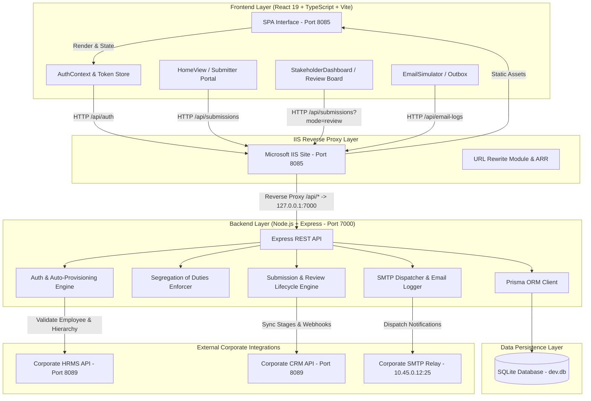
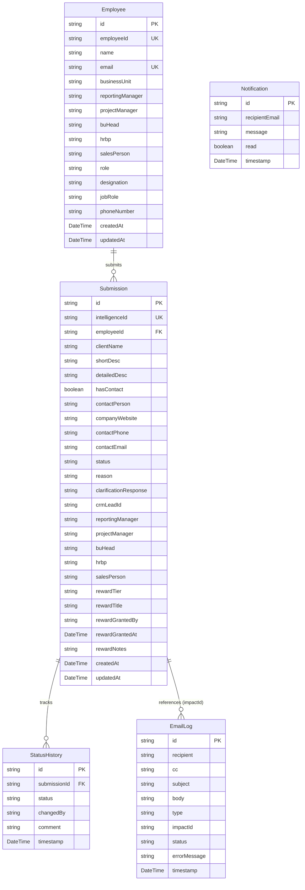

# IMPACT Model — Project Architecture & Data Flow

> **Technical Architecture Reference**  
> **Target Audience:** Software Architects, Lead Developers, and AI Coding Agents (Antigravity)  
> **Status:** Active Production Architecture

---

## 1. System Overview & Architecture Diagram

The IMPACT Model application utilizes a decoupled client-server architecture with an IIS reverse-proxy frontend and a Node.js REST API backend connected to SQLite via Prisma ORM.



---

## 2. Frontend Architecture & Routing Table

The frontend is single-page application built with React 19, Vite, and Tailwind CSS. State is managed at the top-level in [`src/App.tsx`](src/App.tsx) and synchronized reactively across views.

### Routing Table

| Route | Component | Access Control | Description |
| :--- | :--- | :--- | :--- |
| `/` or `/home` | `HomeView` | Authenticated | Submitter home page. Displays personal stats, "My Opportunities" card list, search, lifecycle tracker modal, and clarification response form. |
| `/submit` | `EmployeePortal` | Authenticated | Multi-field opportunity registration form. Validates client, contact details, short/detailed descriptions, and team stakeholders. |
| `/reviewer` | `StakeholderDashboard` | Reviewers / BU Heads / Admins | Leadership review queue. Displays review metrics, SLA overdue alerts (7-day window), search, filter, and validate/reject/clarify actions. |
| `/status/:id` | `StatusRouteWrapper` → `HomeView` | Authenticated | Submitter deep link (from confirmation emails). Automatically opens the specific submission tracking modal. |
| `/review/:id` | `ReviewRouteWrapper` → `StakeholderDashboard` | Reviewers / BU Heads / Admins | Reviewer deep link (from reviewer notification emails). Automatically opens the lead detail view and action panel. |
| `/outbox` | `EmailSimulator` | Authenticated | Internal notification hub. Displays sent and queued email logs with category filters (`Lead Submitted`, `Clarification Needed`, `Validated`, `Deal Won`, etc.). |
| `/db` | `DbViewer` | Admin Role Only | Visual database inspector. Displays raw records from SQLite tables (`Submissions`, `Employees`, `EmailLogs`, `StatusHistory`). |

---

## 3. Database Schema & Data Models

The data layer is managed using Prisma ORM with SQLite. The complete schema is located at [`server/prisma/schema.prisma`](server/prisma/schema.prisma).

### Entity Relationship Diagram



---

## 4. Authentication & Auto-Provisioning Flow

1. **Authentication Attempt:** The user enters credentials on [`LoginScreen.tsx`](src/components/LoginScreen.tsx) (`POST /api/auth/login`).
2. **HRMS Verification:**
   - The server queries `CORPORATE_API_URL` (`https://hrapps.nestdigital.com:8089`).
   - If verified, the response includes the employee's corporate details, business unit, and reporting hierarchy.
3. **Local Fallback:**
   - If the corporate HRMS API is offline or unreachable, the system queries the local database for existing employees or checks predefined role maps (`ROLE_MAP`).
4. **Auto-Provisioning / Sync:**
   - The user record in the local `Employee` table is created or updated with latest HRMS hierarchy data.
5. **JWT Token Issuance:**
   - A signed JWT token containing `employeeId`, `email`, `name`, and `role` is returned and stored in `sessionStorage` (`impact_token`).

---

## 5. Opportunity Registration & Review Lifecycle

### Registration (`POST /api/submissions`)
1. Generates a unique **Intelligence ID** in the format `IM-YYYYMMDD-XXX` (e.g. `IM-20261020-001`).
2. Persists the submission with initial status: **`Opportunity Accepted`** (or `Under Review`).
3. Logs the initial status in `StatusHistory`.
4. Asynchronously dispatches:
   - **Submitter Confirmation Email:** To the author, linking to `/status/:id`.
   - **Reviewer Notification Email:** To RM, PM, BU Head, Sales Person, and HRBP, linking to `/review/:id`.
   - *Note: The submitter's own email is strictly omitted from the reviewer recipient list.*

### Review Decision (`PATCH /api/submissions/:id`)
Reviewers can take one of three primary actions:
1. **Validate:**
   - Status updates to `Validated`, followed by automated transition to `Lead Registered` in the CRM pipeline.
   - Pushes lead payload to `CRM_API_URL`.
   - Sends confirmation mailers to submitter and stakeholders.
2. **Reject (Mandatory Reason):**
   - Status updates to `Closed - Not Valid`.
   - The rejection reason is stored in `reason` and logged to `StatusHistory`.
   - Notification mailer is sent to the submitter.
3. **Request Clarification:**
   - Status updates to `Clarification Requested`.
   - Submitter receives an email and is prompted to submit a response from their `/home` dashboard.

---

## 6. Strict Governance: Segregation of Duties (Four-Eyes Principle)

To ensure corporate compliance:
- **Database / API Layer:** In [`server/src/index.ts`](server/src/index.ts), both `GET /api/submissions?mode=review` and `GET /api/submissions/review-count` include:
  ```typescript
  const notSelfCondition = req.user.employeeId ? { employeeId: { not: req.user.employeeId } } : {};
  ```
  In `PATCH /api/submissions/:id`:
  ```typescript
  if (existing.employeeId === req.user.employeeId && (status === 'Validated' || status === 'Closed - Not Valid' || status === 'Clarification Requested')) {
    return res.status(403).json({ error: 'Segregation of Duties: You cannot review, validate, or reject your own submission.' });
  }
  ```
- **Frontend Layer:** In [`StakeholderDashboard.tsx`](src/components/StakeholderDashboard.tsx), the action buttons (`Validate`, `Reject`, `Request Clarification`) are disabled (`disabled={true}`, grayed out, `cursor-not-allowed`) if `isSelfSubmission(selectedSub)` is true.

---

## 7. Email Dispatcher & SMTP Relay

- **Configuration:** Set via `server/.env` (`SMTP_HOST`, `SMTP_PORT`, `SMTP_FROM`, `EMAIL_SEND_ENABLED`).
- **Relay Type:** Unauthenticated internal corporate relay (`10.45.0.12:25`).
- **Retry Mechanism:** Built-in 2-attempt retry with 1-second backoff.
- **Audit Logging:** Every email attempt is recorded in the `EmailLog` table with status `SENT_TO_SMTP`, `QUEUED`, or `FAILED` and viewable in the Outbox Simulator (`/outbox`).
